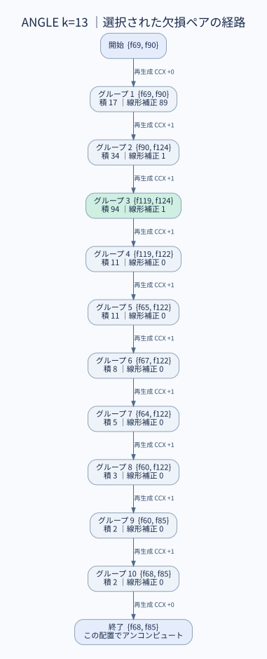
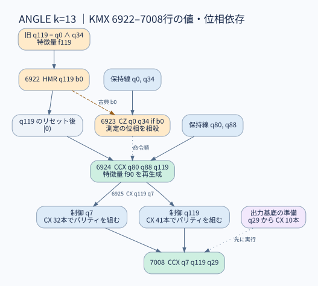
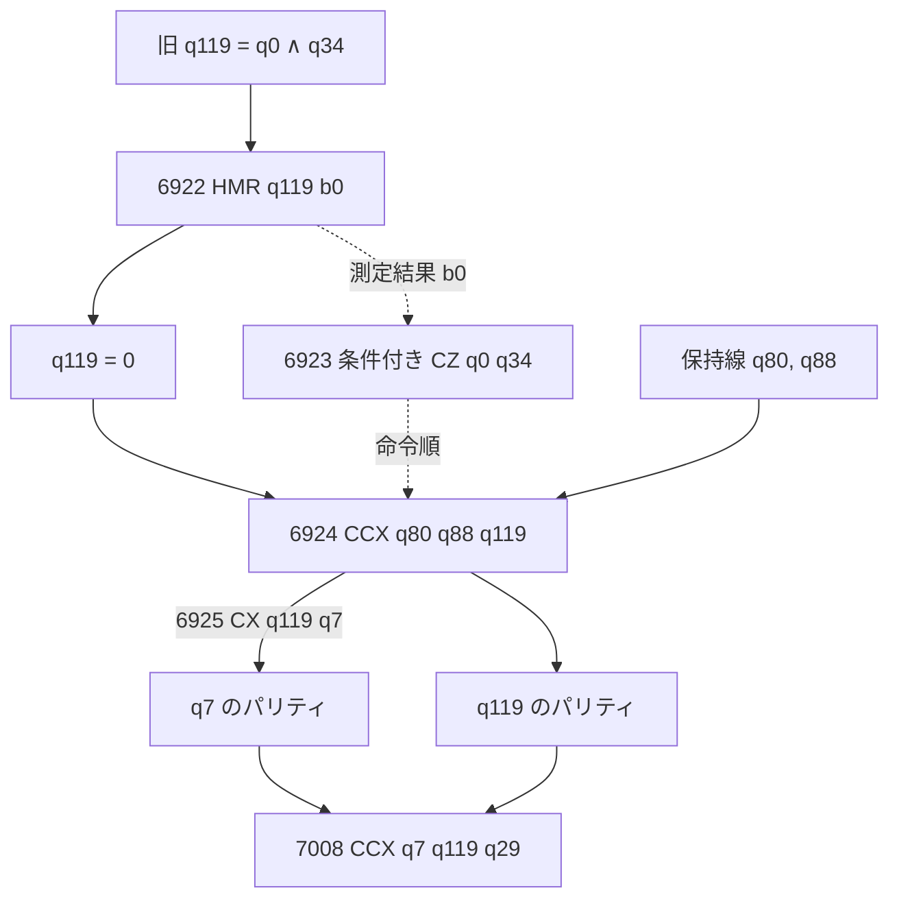

# ANGLE k=13 のグラフと実命令

最終の厳密XOR候補に含まれる `angle_k_13.kmb` を使用した。SHA-256 は `6d8ed72476d067cd207473ea8c706446d224383963e4501839f32796466a9890`。このバッチは128量子ビット、273 Toffoli。図の行番号はKMBをKickMixでKMXに復号したテキストの1始まりの行を示す。レジスタ宣言行を含む。

## 欠損ペアを頂点にした探索

50個の再生成可能な特徴量から、外す2個を選んだ1,225通りが頂点になる。図中の `f119` は論理的な特徴量、`q119` は物理作業線。各頂点で、外した2つを使わずに処理できる積と線形補正を記録する。有向辺 `M → N` は、取り除く特徴量の位相補正と載せ直す特徴量の再生成が共通の保持線だけでできる場合に許す。辺のToffoli費用は `|M ∖ N|`。本バッチでは自己ループを除く有向辺が1,483,168本だった。

下図はビームが選んだ経路。開始は `{f69, f90}`、終了は `{f68, f85}`。10グループが187積と91線形補正を処理し、経路全体の再生成は9 CCX。終了配置で残った幅のままアンコンピュートを実行する。



| グループ | 処理時に外している特徴量 | 積 | 線形補正 | 遷移のCCX |
|---:|---|---:|---:|---:|
| 1 | f69, f90 | 17 | 89 | 0 |
| 2 | f90, f124 | 34 | 1 | 1 |
| **3** | **f119, f124** | **94** | **1** | **1** |
| 4 | f119, f122 | 11 | 0 | 1 |
| 5 | f65, f122 | 11 | 0 | 1 |
| 6 | f67, f122 | 8 | 0 | 1 |
| 7 | f64, f122 | 5 | 0 | 1 |
| 8 | f60, f122 | 3 | 0 | 1 |
| 9 | f60, f85 | 2 | 0 | 1 |
| 10 | f68, f85 | 2 | 0 | 1 |

## グラフの辺が何を実行するか

第3グループに入る辺 `{f90, f124} → {f119, f124}` では、同じ物理線 `q119` を使って保存値を切り替える。



| KMX行 | 命令 | 作用 |
|---:|---|---|
| 6,922 | `HMR q119 b0` | 古い `q119 = q0 ∧ q34` をX基底測定し、`q119` をゼロに戻す |
| 6,923 | `CZ q0 q34 if b0` | 結果 `b0` が付けた位相を相殺する |
| 6,924 | `CCX q80 q88 q119` | 空いた `q119` に `f90 = q80 ∧ q88` を再生成する |
| 6,925 | `CX q119 q7` | 再生成した値を次の制御パリティに足す |
| 7,008 | `CCX q7 q119 q29` | 組み立てた2制御の積で出力基底の `q29` を更新する |



この87行の完全な命令列と、パリティ形成に使用した全CXのソースは [angle_slice.json](angle_slice.json) に収録した。図では制御用CXを束ねて描き、値・位相・命令順の依存を示す。出力側のファンアウト準備10本のCXは、7,008行のCCXより先に実行される。

6,922行の測定結果を `m` とすると、測定と補正の符号指数はどちらも `m × q0 × q34`。2つの符号を掛けると1に戻る。抽出器は1,220アドレスについて `q119` の測定前の式を全て照合し、40入力ビットを記号のまま保持して、図の区間の出力更新も照合する。回路全体の等価性は同じKMBに対応する独立の [全バッチ証明](../final_proof.json) を参照。

## 再現

[angle_route.json](angle_route.json) は全選択経路・処理項・KMX行・バイナリのSHA-256を含む。`extract.py` は実回路のビームを再実行し、再書き出したKMBのSHA-256が検証済みファイルと一致した場合に図データを保存する。`render.py` はそのJSONからDOTとSVGを作る。GraphvizとNoto Sans CJK JPを使用した。

```sh
python extract.py --repo "$REPO" --scheduler "$SCHEDULER" \
  --compiler "$OPEN_CACHE_DIR" --leaves "$LEAF_CENSUS" \
  --selected "$OPEN24_DIR/cache_receipt.json" \
  --reference "$SCORE12_DIR/angle_k_13.kmb" \
  --verified "$VERIFIED_DIR/angle_k_13.kmb" --out .
python render.py .
```

このバッチのKMBはビーム幅24で選んだ版から引き継がれ、最終候補の同バッチにも同じバイト列が入っている。`OPEN24_DIR` にはバッチの経路選択記録、`OPEN_CACHE_DIR` には `open_cache.py` を置く。
