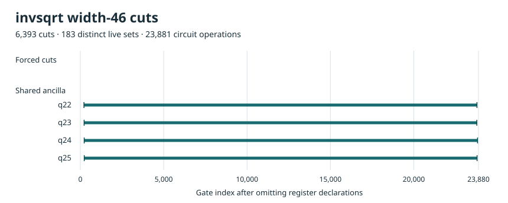

# 最高版で試すグラフ最適化と検証ツール

対象は [score18](../score18_scorecard.json) の `invsqrt.kmb`。総合ローカルスコアは **27.328123503355716**。元の回路、採点用ZIP、公式検証器には変更を加えていない。

## 46量子ビットを強制する切断点

[依存関係と生存区間の解析](../invsqrt_graph/width_dag.py)で、条件スコープをまとめたDAGを使う。作業値が生成される命令が切断点より前に必要で、消去命令が切断点より後に必要なら、切断点でその作業値が生存する。

最高版では入力22本と作業値24個が同時に必要になる切断点が6,393箇所ある。そこでの作業値の集合は183種類。全集合の共通部分は `q22`, `q23`, `q24`, `q25` の各一つの生存区間だった。これは固定した依存グラフの切断点についての結果で、再計算のコストや45量子ビットでの実現可能性は未確定。



`q25` は全3,133,452合法入力で、102利用箇所すべてで `x < 64` の判定値だった。うち27箇所では、`q25` が異なり他の45量子ビットの基底値が一致する合法入力がある。例えば命令番号7621の `CSWAP q25 q41 q2` の直前で `x=1` と `x=65,536` が衝突する。この点では他の量子線からのその場での再計算ができないため、保持する値の符号化や正規化の回路構成を変える必要がある。[切断点の集計](critical_cut_cover.json)・[衝突の証拠](q25_recoverability.json)

次の探索ではこの4区間の値について、最終利用まで保持する構成、必要になる直前に計算する構成、測定で解放して補正を後へ移す構成を比較する。HMRで値を解放するときは測定結果を `m`、解放する値を `f(x)` としたときの位相 \((-1)^{m f(x)}\) を補償する。候補の再計算と補正をKMXへ落とし、作業値の生存区間と公式費用を再計算する。

既存の[積移送による試作](../invsqrt_graph/product_transfer.json)は最初のピークを消して全3,133,452入力・各1ショットでPASSしたが、後続ピークが残って46量子ビットだった。今回の集合の共通部分は、元のグラフの複数ピークにまたがる候補を選ぶために使う。

## 実装の対応

| 目的 | ツール | 適用先 |
| --- | --- | --- |
| 測定を含む再計算の探索 | [Quist–Laarmanのspooky pebblingソルバ](https://github.com/Quist-A/spooky-pebble-game)・[論文](https://lmcs.episciences.org/17091) | 小さな依存部分グラフで測定、再計算、位相補正の順序を探す |
| 最大幅・累積コスト制約 | [OR-Tools CP-SAT](https://github.com/google/or-tools/blob/stable/ortools/sat/docs/scheduling.md) | 構成ごとの生存区間とToffoli費用を入れて、同時生存と再計算費用を制約する |
| ANDの削減と可逆コンパイル | [mockturtle](https://mockturtle.readthedocs.io/en/latest/algorithms/resubstitution.html)・[Caterpillar](https://github.com/gmeuli/caterpillar) | C++でXOR–ANDグラフの内部を書き換える。CaterpillarのSAT pebblingで可逆化のスケジュールを比較する |
| 大会形式の比較と高速検証 | [KickMix](https://github.com/quantumlib/Qualtran/tree/main/kickmix)・[kickmix-engine](https://github.com/manwithacat/kickmix-engine) | `.kmb` を評価。Rust版READMEの `diff` と `verify --cross-check` で公式器との比較ができる |
| 実回路の表示と小区間のクロスチェック | [KickMix viewer](https://github.com/manwithacat/kickmix-macos/tree/main/tools/circuit-viewer)・[Cirqの古典制御](https://quantumai.google/cirq/build/classical_control) | 作業ビットの寿命を可視化。小さな等価変形の測定分岐と位相を別実装で確認する |
| 位相回路の図示と局所簡約 | [PyZX](https://github.com/zxcalc/pyzx) | ユニタリ区間をZX図で見て簡約候補を探し、大会命令に戻して費用を測定する |

これらの外部パッケージは候補。今回の生存区間調査には既存のKickMixと依存グラフ解析を使った。

## 外部の公開回路を公式検証器で比較

[公開 `invsqrt.kmb`](https://github.com/alexon-v8/quantum-circuit-compilation-invsqrt) のREADMEでは費用22,411.95と報告されている。公開バイナリとscore18のバイナリを同じ未改変の公式 `verify_submission_invsqrt.py` で比較した。

```sh
python "$VERIFIERS/invsqrt/verify_submission_invsqrt.py" "$CANDIDATE" \
  --max-x 64 --shots-per-x 1 --seed 0 --batch-size 64 --max-workers 1
```

| 回路のSHA-256 | 出力 |
| --- | --- |
| `8ffcd4da89fd3c7270005a364e8840b795d209cec8d830e93fe7486cd8e2e7b2` | FAIL、`x=1`で位相誤差 −0.3119 turns、許容値 5.960e−08 |
| `684106f101730ca193627229920a0501bef9ea10ccfb34aa453fcf63edadb50a` | PASS、64入力、最悪誤差比 0.70590090 |

検証器SHA-256は `ddef520dec6b68d1cf0a6f328ddd36d79eb84570b9192cf3f7acaf073f06733a`。64入力の検査は外部回路の反例と既存回路の対照用。公式費用の比較には全域検証の score18 の値を使う。

[公式検証器の出力と実行条件](public_invsqrt_smoke.json)

## グラフ解析の再現

```sh
python critical_cut_cover.py "$PINNED_INVSQRT_KMB" cuts.json --svg cuts.svg
python q25_recoverability.py "$PINNED_INVSQRT_KMB" q25.json
```
