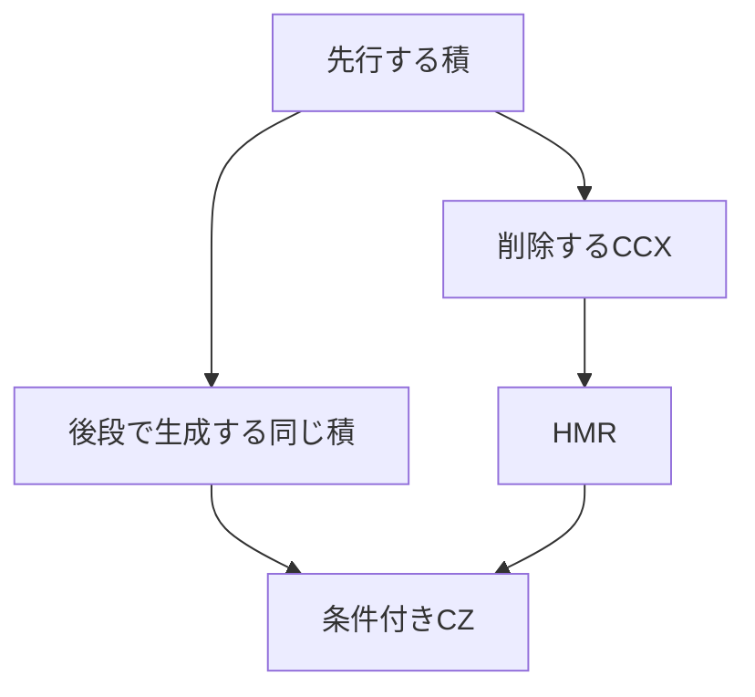

# 最高版からの測定位相の再合成と化学の係数更新

score18の18ファイルを起点に、化学の `W` と `H2_I` を再最適化した。総合ローカルスコアは **27.328123503355716 → 27.328123505373940**。改善量は `2.0182e-9`。化学の未改変公式検証器で **78,080ショットPASS**。`Q=427`、Toffoli `14,722`、15本のANGLEは採点元とバイト一致。既存ANGLEの任意初期語に対する反例も引き継ぐ。DQIと逆平方根はscore18と同じメンバーで、以前の公式検証費用を使う。Kaggle提出は0件。

| 係数の探索 | 化学費用 | 総合ローカル |
| --- | ---: | ---: |
| score18 | 294878855.82798020 | 27.328123503355716 |
| 通常の再最適化 | 294878855.79166555 | 27.328123504477542 |
| 基底の重なりを重みとしたグラフで再最適化 | 294878855.76264834 | 27.328123505373940 |

化学では固定した1,220行の整数角度表を使う。グループ内の二体基底 $v_i$ を頂点とし、辺の重みを $w_{ij}=(v_i^\top v_j)^2/(\|v_i\|^2\|v_j\|^2)$ とする。各頂点の重み付き次数を使って既存の対角曲率を調整し、相関の強い基底の近傍で更新を小さくする。最終判定には同じ係数の通常探索と公式検証結果を使用した。別の、列の直交回転による最大重みマッチングは改善辺0件だった。

[グラフを使った係数更新](chemistry/refit.py) · [公式結果](chemistry/overlap_official.json) · [通常の再最適化の比較](chemistry/restart_official.json) · [スコアとハッシュ](score19_scorecard.json)

## 逆平方根の回路書き換え

有料ゲートを削除して生じた差分を依存グラフに伝える。HMRや対角ゲートで現れる符号差を、測定値の版と条件スコープで束ねる。測定値が上書きされる前の複数の切断点で、残存ワイヤの一次項と二次項のGF(2)線形包から補正を合成する。追加の補正はNEG、Z、CZを用いる。量子入力と作業線が同じ状態に戻ることも条件にする。

検証用の小回路では後段の積を再利用し、**Toffoli 3→2**。合法基底入力8通りとKickMixの128ショットで入力・作業線・位相を照合した。測定値の上書きを挿入した場合にその書き換えを拒否することも確認した。



実回路は `684106f101730ca193627229920a0501bef9ea10ccfb34aa453fcf63edadb50a`。1,541ゲートの単独削除を2,048合法入力で検査し、199件でデータが復元した。最初の未解決位相が同じ削除を結び、88ペアも検査した。補正の挿入範囲は各測定から最大288命令。単独・ペアとも、このモデルで位相を復元できる候補は0件。全域検証や新規採点に進んだ逆平方根の候補はない。

[書き換え器](invsqrt/rewrite.py) · [実回路の結果](invsqrt/report.json) · [小回路の検証](invsqrt/fixture.json)

## ほかの縮約の調査記録

- 逆平方根の幅削減では、`q25` の前後の制御SWAPを対で除く12案を全63有効入力で調べた。データは復元したが、すべて位相許容を超過した。[幅の調査](experiments/width/README.md)
- DQIは58,868,734命令で位相・条件スコープをまたぐ562区間の階数を調べ、削減0。既存の有限体写像について、同時に計算する一次式の積を13個から12個へ減らすモデルも、列挙した範囲では成立例0。[DQIの調査](experiments/dqi/README.md)
- 化学ANGLEの出力依存性に沿って36,213支持の積を探索し、階数2以下の結合0。支持数の制限を外したSATは3バッチで時間上限に達した。[ANGLEの調査](experiments/chemistry/README.md)
- 大きい区間の可逆積の組み替えと、逆平方根の位相基底も独立に調べた。[積の組み替え](experiments/tensor/README.md) · [逆平方根の基底とキャッシュ](experiments/phase_basis/README.md)

## ZIPの再現

元の `score18_local.zip` はSHA-256 `73f34380df7190eb4e4ec7433ccf6ea61dfe463a3def9b35a8b33be00083da9a`。元版のスコア表を `SCORE18_JSON`、元ZIPを `SCORE18_ZIP` とする。候補ZIPは18ファイルのSHA-256を照合済み。

```sh
python ../score18_high_baseline/chemistry/stage.py "$SCORE18_ZIP" "$SCORE18_JSON" weights_xor_patch.npz family19 --xor-patch
OPENBLAS_NUM_THREADS=1 OMP_NUM_THREADS=1 python "$VERIFIERS/dfthcsos/verify.py" family19 > official19.json
python ../score18_high_baseline/build_portfolio.py --zip "$SCORE18_ZIP" --scorecard "$SCORE18_JSON" --family family19 --chemistry-receipt official19.json --out score19_local_candidate.zip --receipt score19_scorecard.json
python invsqrt/fixture.py
python invsqrt/rewrite.py "$PINNED_INVSQRT_KMB" invsqrt --span 24000 --phase-span 288 --merge-phases
```
