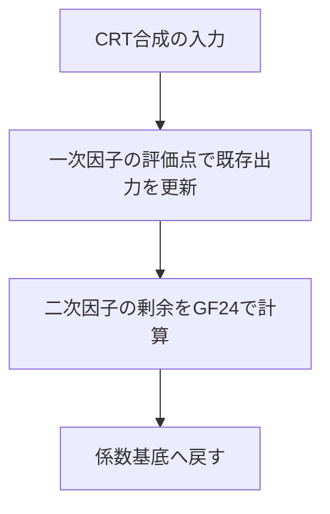

# score20 ローカル採点とDQIの最大幅

ローカル総合スコアは **27.32812350537394 → 27.336376956535183**。
既存のscore19の18ファイルから逆平方根のKMBを差し替え、全ファイルの
SHA-256を照合した。Kaggle提出は行っていない。

| 課題 | score19の費用 | score20の費用 |
| --- | ---: | ---: |
| 逆平方根 | 78,673.55534364567 | 78,602.3170459352 |
| DQI | 359,707,293,756.04297 | 359,707,293,756.04297 |
| 化学 | 294,878,855.76264834 | 294,878,855.76264834 |

逆平方根では、測定結果により使われる一時積だけを生成し、生成を省いた
場合の測定位相を補償した。全入力各64ショットの公式検証
200,540,928ショットを通過。公式費用に使う平均Toffoliは
1,478.7506100300882から1,477.2019513842083へ下がった。
量子幅は46、反応深さは1,336から1,346へ増えた。
詳細は [逆平方根の実装と再現手順](score21_inv_lazy/README.md)。

## DQIの実回路におけるピーク

- 固定したscore19のe4について、58,868,734命令を条件分岐に沿って解析。
  幅889に達する1,980区間、9,484,383命令位置を列挙。
  [区間一覧](score21_dqi_pebble/q889_intervals.tsv)。
- 命令と全オペランドが一致した99-CCXの消費型GF24乗算は192箇所。
  そのうち162箇所が幅889と交差し、881,728位置を占める。
  残るピーク8,602,655位置には別の変換が要る。
  [GF24照合結果](dqi_census/census.json)。
- スクラッチ線の二次式をCX・SWAPなどで追跡し、初期式の位相を補償して
  空け、後の式で再生成できる区間を列挙した。
  個別に適用できる区間の和集合は1,790,548ピーク位置。
  互いに依存する区間があり、これは同時配置の結果ではない。
  [早期消去の解析](score21_dqi_pebble/transport_coverage.json)。

この解析は全量子入力を未知とし、条件分岐の合流では両枝で0を保証できる
線を解放可能と数える。範囲は0始まり、終端を含まない。

## 実装した幅削減

消費型の乗算・共役乗算・除算は GF((2^12)^2) の12ビット成分に分けた。
係数をその場で変換し、シュール分解による二つの半語の更新で作業線を再利用する。
3方式それぞれの追加作業線は24本から14本。静的課金ゲートは乗算が
99から852、e4と命令照合できた除算が291から852。各16,384ショットで
値、位相、作業線の初期化を確認した。対象は非零係数および両入力が零のケース。
[GF24の実装](score21_dqi_schur/README.md)。

実際のe4では82個のGF4096逆元位相ブロックを、位相を直接作用させて
作業線を早く解放する回路へ交換した。静的課金382,894は維持し、
ピーク889の命令位置は9,484,383から8,607,724に減った。
置換範囲内の最大幅は888。変更版の全回路を公式検証器で1,024ショット
（縮小パラメータ、固定seed）実行し、値・位相エラーは共に0。
全回路の最大幅は889だったため、採点用ZIPのDQIはscore19を採用した。
[全回路の検証](dqi_phase_peak/stock_smoke.json)。

Fループは後の補償にしか使わない値を途中でHMRする。5点の実機形式部品で、
二つのフラグを除く作業線は23本から14本、静的課金は302から365。
元の回路と変更版それぞれ8,192ショットで値と位相を確認した。
[Fループの検証](dqi_census/f_result.json)。

CRT合成では一次因子上の評価を既存出力へ直接反映し、二次因子の剰余
だけを別に評価する。次数34の部品について、スカラー更新198,826命令の
間の追加作業線は0本で、二次剰余の計算は24本を要する。元の部品と
変更版で接頭部・往復を各2,048ショットずつ値と位相を照合した。
課金ゲートは接頭部1,512から1,527、往復3,303から3,318。

この部品をe4の次数34ステージと全オペランド照合し、実際に置換した。
そのステージの幅889の命令位置は373,046から5,057へ減った。残りは
すべて二次剰余のGF24乗算内にある。実回路の公式検証器1,024ショット
（縮小パラメータ、固定seed）で値・位相エラーとも0。最大幅は889。
[CRT置換後のプロファイル](dqi_census/crt_width_coverage.json)。



## 再現

`GVQCC` は既存のリポジトリ、`DQI_E4` はscore19の `dqi.kmb`。
このディレクトリ内を作業ディレクトリに指定する。

```sh
g++ -O3 -std=c++20 "$GVQCC/score5_dqi_width_branch.cpp" -o /tmp/dqi-branch-width
/tmp/dqi-branch-width "$DQI_E4" /tmp/e4-lifetimes.tsv
g++ -O3 -std=c++20 score21_dqi_pebble/idle_products.cpp -o /tmp/dqi-idle-products
/tmp/dqi-idle-products "$DQI_E4" 840 /tmp/e4-gaps.tsv
python score21_dqi_pebble/coverage.py /tmp/e4-lifetimes.tsv /tmp/e4-gaps.tsv /tmp/coverage.json \
  --peak-intervals /tmp/q889.tsv
python score21_dqi_pebble/check_gaps.py "$DQI_E4" /tmp/e4-gaps.tsv /tmp/native-gaps.json \
  --repo "$GVQCC" --census dqi_census
```

ZIPの組み立てには `assemble_verified.py` とscore19 ZIP・scorecardを用いる。
逆平方根の再現手順で `base` にscore19 ZIP内の `invsqrt.kmb` を指定する。
