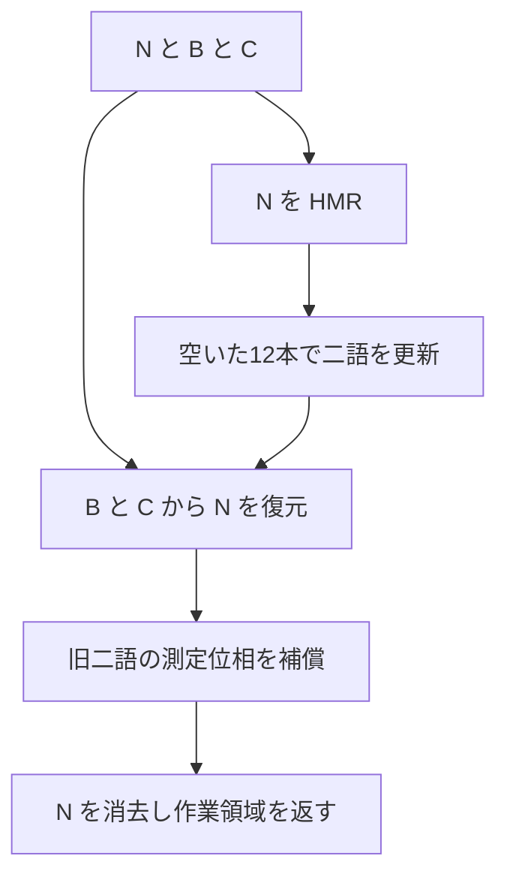

# DQI第三ピボットの作業領域を12本削減

GF24第三ピボットの前段と戻りに、`score19_dqi_frobenius` の12ビットnorm領域を再利用する回路を移植した。両区間の保守的な生存幅は889から877になった。別のGF24・extractor区間も幅889に達するため、全回路の幅は889である。

## レジスタと位相

(N) をGF24のnorm、(B=N^{-1}) をその逆元、(C) を (N) の子normとする。(B) のtower座標が ((L,R)) のとき、零を含めて (N=((L+R)C,RC)) が成立する。元の物理位置にある24本のcarryと条件フラグを保つ。



更新前の二語を測定した結果を古典ビットに保持し、復元した (N) と更新後の二語から古典条件付きCZで位相を補償する。三回のnorm復元に30 CCXずつを使う前段・戻りの合計増分は180課金ゲート。テンプレート内の二つの終端CCXは、対象線に途中の操作がないことを確認して既存のHMRと条件付きCZに融合した。

## 全回路への束縛

1. 旧テープの二スパンをテンプレートの全命令と全オペランドで照合する。
2. 保存済みe4のHMR置換と、位相・CRT・外側GF12の各スプライス座標を順に適用する。変換した全オペランドを入力テープで再照合する。
3. 変更範囲で書き込む82個の旧物理古典ビットについて、119区間の上書きと読み出しの支配関係を確認する。新旧範囲の外側と量子ABI・古典ABIを保持する。
4. 分岐ごとの定数解析から作った生存区間を集計する。スパン幅、全体の幅、残存ピーク位置を `width_diff.json` に保存する。

### 8本貸出し版との結合

| 項目 | 元KMB | 結合KMB |
| --- | ---: | ---: |
| 第三ピボットの前段と戻りの最大幅 | 889 / 889 | 877 / 877 |
| 全回路の最大幅 | 889 | 889 |
| 幅889の操作位置数 | 2,912,577 | 2,903,150 |
| 静的課金ゲート | 387,292 | 387,472 |

入力SHA256は `3e50000e18f2f1746de3270cf88c10d7b6ea3f577988a3cd13ba1f90a8da48e2`。出力SHA256は `0b17bdfd4eb5d516f8ef522d7e149d614da4ce6f7b3439b9b4772a05e9262dbe`。公式検証器の1,024ショット（seed 7、log2 delta −12）でPASSし、値と位相の誤りは各0件。結果は `hmr_final/stock_smoke.json`。

## 再現

`WORKSPACE` は `dqi_phase_peak`、`score19_dqi_frobenius`、`score22_dqi_crt_phase` を含むディレクトリ。`PREV_ROOT` は旧テープ `score5_norm_fanout_fanin/dqi.kmb`、e4のパッチ `score5_norm_final/patch.json`、コンパイル済み幅監査器 `score5_dqi_width/branch` を含む。 `REPO` は gvqcc のKMBライブラリを含むチェックアウト。 `VERIFY_DQI` は配布版 `verifiers/dqi/verify_submission_dqi.py`。

```sh
CHART="$WORKSPACE/score23_dqi_chart"
INPUT="$WORKSPACE/score22_dqi_crt_phase/loan8_production"
OUT="$CHART/replay"
mkdir -p "$OUT"
export PYTHONPATH="$REPO:$WORKSPACE/dqi_phase_peak"
python "$CHART/splice_chart.py" "$WORKSPACE" \
  "$PREV_ROOT/score5_norm_fanout_fanin/dqi.kmb" \
  "$PREV_ROOT/score5_norm_final" "$OUT" --hmr-scan "$CHART/hmr_strict.json" \
  --latest-dir "$INPUT" >"$OUT/splice.json"
"$PREV_ROOT/score5_dqi_width/branch" "$OUT/dqi_chart.kmb" "$OUT/lifetimes.tsv" >"$OUT/lifetimes.json"
python "$CHART/compare.py" "$INPUT/loans_lifetime.tsv" "$OUT/lifetimes.tsv" \
  "$OUT/splice.json" "$OUT/width_diff.json"
OPENBLAS_NUM_THREADS=1 python "$VERIFY_DQI" "$OUT/dqi_chart.kmb" --format kmb \
  --num-shots 1024 --batch-size 256 --log2-delta -12 --seed 7 --max-workers 1 >"$OUT/stock_smoke.json"
```

外側GF12の12本貸出し回路と組み合わせる場合は、`INPUT="$WORKSPACE/score23_outer_word"` を指定する。入力SHA256は `9888d2b455cdf4e22f2e0dd5af1e8032c6370e644f44e5ac5b071641b68793e0`。結合結果の検証記録は `full_word/`。
